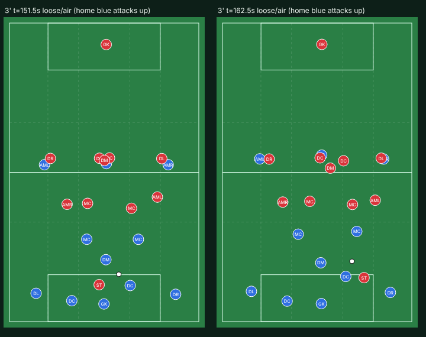
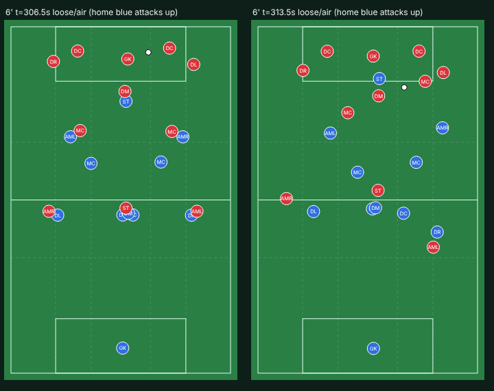
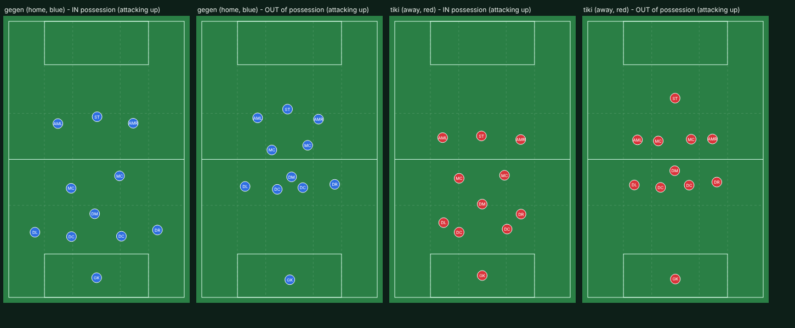

# Match analysis: Gegenpressing (home, blue) v Tiki-taka (away, red), first half

Live engine 2026.10.21.26, seed 20261021, both teams' standard style presets and roles. Score at half-time 3-0.
Read as a match analyst: possession chains (`chains.txt`), average positions, line heights by ball zone and
freeze-frames. Distances are measured from each team's own goal line. Nothing in the engine was changed for this.

## The game in one paragraph

Blue's press is the best thing on the pitch: a compact 4-3-3 about 20 m deep, its striker screening red's 6 and
its wingers jumping onto red's full-backs. Red, a positional-play side, cannot play through it (1.9 passes per
possession, 34% possession) because it builds from far too deep and never puts anyone between blue's lines. But
blue, with the ball, plays like a frightened team: 52 passes back to its own keeper in one half, 28 lofted balls
backwards to its own keeper or centre-backs, a team 48-56 m long that never moves up behind the ball. Blue's
goals came from the moments it went forward quickly (for example at 4': striker → through ball → inside forward
→ late 8 shoots), which is exactly what a gegenpressing side should do all the time.

## What is good

- **Blue's high press** (out of possession): back line about 47 m out, front line about 76 m, a 39 m block; the
  striker blocks the pass into red's 6 (cover shadow, rulebook 4.6); wingers press full-backs from inside.
- **Blue's direct attacks** when they happen: vertical, 2-3 passes, runners beyond (rulebook 9.1).
- **Red's out-of-possession 4-1-4-1** is tidy and compact.

## What a coach would be angry about

1. **Build-up from far too deep, against one presser** (both teams). Freeze-frames 3' and 6':
   centre-backs stand inside their own box (one at the 6-yard line), full-backs level with them, the keeper
   gets the ball back again and again. Red presses with **one** man; blue has six against him and still plays
   back to the keeper. Rulebook 6.2/6.3: centre-backs split to the edge of the box, full-backs give width
   higher up, a free centre-back **carries the ball into midfield**.
   
2. **Nobody between the lines** (both teams). In blue's build-up red's midfield line is about 38 m from blue's
   goal and red's back line about 57 m: the 20-25 m pocket between them is empty. Blue's 8s stand at 36 m, in
   front of red's midfield; the front three stand flat on red's back line. So there is no forward pass, only
   sideways and back. Rulebook 3.2-3.5, 6.5, 6.6: the 8s receive in the half-spaces between the lines, a 10 or
   a dropping forward lives in that pocket; when one drops, another runs beyond (third man).
3. **The team does not move up behind the ball** (blue). With the ball in the middle third the back line is
   at 34 m and the front three at 71 m (48 m long); in the final third 41 m and 81 m (50 m long). A dominant
   side squeezes up to about 35-40 m long with the back line near halfway, which also makes the counter-press
   work (rulebook 3.7, 5.4 step 2).
4. **Lofted balls backwards** (blue, 28 in a half): a centre-back or midfielder chips a 33-40 m ball back to
   his own keeper or the other centre-back. Not a football action; the long ball is a forward or switching
   pass (rulebook 3.6, 3.8).
5. **Inverted full-backs do not invert** (red). They stay wide at the depth of the centre-backs instead of
   stepping into midfield beside the 6 (rulebook 6.3), so red's 2-3 shape for playing out never exists.
   

## Line heights (blue, in possession)

| Ball in | Back line | 8s | Front three | Team length |
|---|---|---|---|---|
| Own third (build-up) | 15 m | 36 m | 62 m | 56 m |
| Middle third | 34 m | 51 m | 71 m | 48 m |
| Final third | 41 m | 64 m | 81 m | 50 m |

## What I think is happening (to confirm in the code before changing anything)

- The in-possession shape is anchored to formation spots that slide only part of the way with the ball, and
  the build-up phase holds the defenders on their own box; nothing tells a free centre-back to step in with
  the ball or the line to squeeze up behind it.
- The 8s' job (receive between the lines) is not expressed relative to the **opponent's lines**: they are
  placed by our formation and the ball, so they end up in front of the opposition midfield.
- The carrier's choice values a safe pass to the keeper highly when nothing forward is open; with nobody
  between the lines, nothing forward is ever open. The backward lofted pass is just "a safe long option".

## Proposed fixes, in football terms (for review before implementing)

1. **Build-up structure (6.2, 6.3, 6.4):** centre-backs split to the edge of the box; full-backs higher and wide
   (or inverting beside the 6 for Inverted Full-Backs); the 6 shows between or in front of the centre-backs.
2. **Occupy the space between the opponent's lines (3.2-3.5, 6.5, 6.6):** 8s and 10s position relative to the
   opponent's midfield and back lines, in the half-spaces; a forward drops into the pocket while another runs
   beyond.
3. **The free centre-back carries it (6.2):** with no presser within about 10 m, a centre-back drives into
   midfield until someone comes out to him (which frees a team-mate).
4. **The team squeezes up behind the ball (3.7, 5.4):** in progression and attack the back line follows the ball
   up to about halfway; rest defence stays 3+2.
5. **No lofted passes backwards (3.6, 3.8):** a long ball goes forward or across (switch), never back to your own
   keeper or centre-back.

How I'd check them: replay the same matchup, look at the same moments and line heights, and add long ball v low
block as a second matchup to make sure the fixes hold for a different game.
