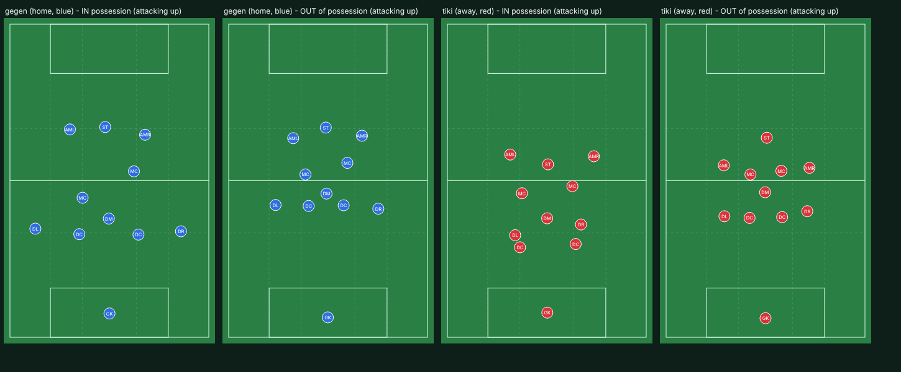

# Analyst report 2: what the first round of fixes did, and what it uncovered

Engine after iteration 2 (not released). Same match as report 1 (gegen v tiki, seed 20261021, first half) plus a
league check on three seeded worlds (100 matches each, every club and style), compared with the live engine on the
same worlds. Every change below starts from a rulebook section, which was written or extended first.

## The game in one paragraph

Blue now plays like a dominant pressing side: the back line holds 28 m out in build-up (15 m before) and up to 48 m
in the final third, the team is 45-47 m long instead of 48-56, and passes back to the keeper fell from 52 to 19
in the half. Red still cannot play through blue's press (1.9 passes per possession, 32% of the ball), which is a
fair result between these two styles but is the next thing to examine. The bigger story of this round is what the
better attacking play exposed: once teams reached the box, our defending was letting attackers in alone.

## Line heights (blue, in possession), before and after

| Ball in | Back line | 8s | Front three | Team length |
|---|---|---|---|---|
| Own third | 15 -> 28 m | 36 -> 39 m | 62 -> 63 m | 56 -> 46 m |
| Middle third | 34 -> 37 m | 51 -> 49 m | 71 -> 70 m | 48 -> 45 m |
| Final third | 41 -> 48 m | 64 -> 63 m | 81 -> 84 m | 50 -> 47 m |

## What the analysis found (and fixed)

1. **Chances were too clean.** In about 75% of shots nobody stood between the shooter and the goal (real matches:
   most shots go through at least one body). Freeze-frames showed defenders in the box but beside or behind their
   man, and keepers caught on the wrong line.
2. **The shot model was blind to the keeper and the bodies in the way** (distance and angle only, plus a fixed
   one-on-one value). Rebuilt on the structure professional shot models use (rulebook 7.5): distance, the
   goal-mouth angle, how much of the goal the shooter can see past the keeper and defenders, bodies in the shooting
   triangle, pressure and shot type. Our own numbers, fitted to public reference values (0.4 from 6 m, about 0.22
   from the spot, 0.13 from the box edge, 0.04 from 25 m or a tight angle).
3. **The keeper stood in the middle of his goal at tight angles and jogged across after a cut-back** (rulebook 6.1):
   he now stands on the line from the middle of his goal to the ball (the near post at a tight angle) and resets
   at full speed with every pass near his goal.
4. **Defenders near their own box jogged** (only a man 15-20 m out of position was allowed to sprint), and marked
   halfway between zone and man (4.8): in and around the box they are now goal-side, touch-tight and at full speed.
5. **The first defender in shooting range went to the passing lane instead of blocking the shot** (4.8): inside
   about 25 m he now comes at the ball goal-side; the cover takes the pass inside.
6. **Defenders dived in near their own box** (4.5): they now delay, and commit when the ball is exposed or they
   have cover.
7. **Midfielders dropped behind their own back line chasing runners**, playing everyone onside (4.7): they pass the
   runner on at the line.
8. **Pressed players threaded through balls as if free** (7.1): a through ball now needs time to see the run.

## What did not work, and was taken out

- **The style "preference" change** (making a preferred risky option less bad) and the direct "go early" rule:
  together they added 40% more carries (130 per team, dribble duels 185) and about a goal a match. Reverted.
- **Banning lofted balls back to your own defence** (3.6/3.8): right in principle, but on its own it forced teams
  forward (shots up to 28-32 a match). Out for now; to be redone so the backward ball goes on the ground instead.
- **A sweeper keeper rushing for balls over the top**: no measurable benefit. Removed.
- Kept: **centre-backs stepping into midfield with the ball** (6.2): neutral on the league numbers.

## League (three seeded worlds, 100 matches each)

| | Live engine | This engine | Real football |
|---|---|---|---|
| Goals per match | 3.35-3.68 | 2.51-2.97 (avg 2.74) | about 2.8 |
| Shots | 22-24 | 25-28 | about 25 |
| On target | 7.8-8.3 | 7.8-8.9 | about 8.5 |
| Draws | not measured | 22-36% (avg 30%) | about 25% |

Calibration (league averages only, rulebook 12.8): `ENG.xg` back to 1 (the new shot model is already fitted to
real values), finishing `ENG.fin` 0.85. Note: the 2.73 goals quoted for the release came from a single world; on
seeded worlds the live engine scores 3.35-3.68.

## What a coach would still be angry about (next round)

1. **Tiki-taka cannot keep the ball under a press** (1.9 passes per possession): no third man, keeper not used as
   the extra passer.
2. **Lofted balls back to your own defence** (23 in the half): redo 3.6/3.8 so the safe ball back is on the ground.
3. **Too many ground duels** (about 130 per team; real about 50-60) and big quality gaps turning into blowouts
   (a 90-rated side beat an 84-rated one 14-0 on one seed, on the live engine too).
4. **A free player in the box shoots only about a quarter of the time** (rulebook 7.3 says shoot or square).
5. Offsides about 2.3 a match (real about 4); passes about 720 per team (real 450-550).
