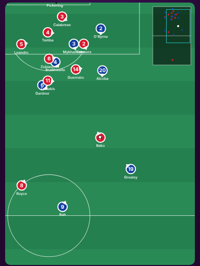

# Analyst report 4: body orientation, and a bug that favoured one side

Engine after round 4 (not released). Rulebook first: new section **1c Body shape**, plus 4.5 duel proportions.

## Body orientation (rulebook 1c)

Every player now faces somewhere, and it matters:
- **Turning takes time** (about half a second to a second, quicker with Agility, slower at full speed); he runs
  fastest forwards, slower sideways, slowest backwards.
- **Defending, he watches the ball** and backpedals to stay goal-side; he turns his back only to sprint back.
- **With his team on the ball he opens up** on the half-turn (Decisions, Vision, Anticipation).
- **Receiving with his back to goal** he needs time to turn; a man tight behind him stops the turn (he shields).
- **Passes and through balls behind where he faces** are harder, a **carry** includes the time to turn, a
  **shot facing away from goal** is worth much less (the shot model's facing term).
- **A defender facing the wrong way cannot tackle** and is easier to beat; a carrier turned away exposes the ball.
- The 2D view shows a small pointer on each player for the way he faces.

Measured in a match: strikers receive with their back to goal 45% of the time (half-turn 28%), central
midfielders mostly on the half-turn (44%, back to goal 7%); defenders face the ball 88% of the time and backpedal
at about 2.3 m/s; one shot in twenty is taken facing away from goal.

## The bug: whoever moved first had an edge

Testing every fixture both ways round with the home advantage switched off, side 0 won 48% and side 1 28-32%.
Both teams move in the same half-second, but the engine moved side 0 first: whatever side 1 read about its
opponents (the carrier slowing with a defender in front of him, and now whether he can turn) was where side 0
would be half a second later. Since side 0 is always the home team, every match since that rule existed carried
an accidental home advantage of about 15 points. Now both sides read where everyone was at the start of the
half-second: 39-41% against 42-44% (equal within noise).

## Duels (4.5)

A take-on beats the defender a bit under half the time (was 62%); a tackle committed when it is on wins the ball
about three times in five (the defender won only 41%).

## League (three seeded worlds, 120 matches each)

| | Round 3 | Now | Real football |
|---|---|---|---|
| Goals | 2.3-2.7 | 2.5-3.0 | about 2.8 |
| Shots | about 21 | 24.6-25.4 | about 25 |
| On target | about 7 | 7.5-7.8 | about 8.5 |
| Home win / draw | 45-53% / 24-25% (with the bug) | 44-52% / 24-27% | about 45% / 25% |
| 0-0 | 7-16% | 9-14% | about 7-8% |
| Wins by 5+ | 3.3-5.8% | 5.0-5.8% | about 3-4% |
| Passes per team | about 730 | about 670 | 450-550 |
| Offsides | about 2 | 2.4-2.8 | about 4 |

Calibration (league averages only): `ENG.fin` 1.12.

## Still to do

Wins by 5+ a little high; successful dribbles about 26 per team (real 8-10); passes still high; offsides low;
fluid roles (the space decides the job). The `mood` test (transfers) fails now and then on the live code too.
